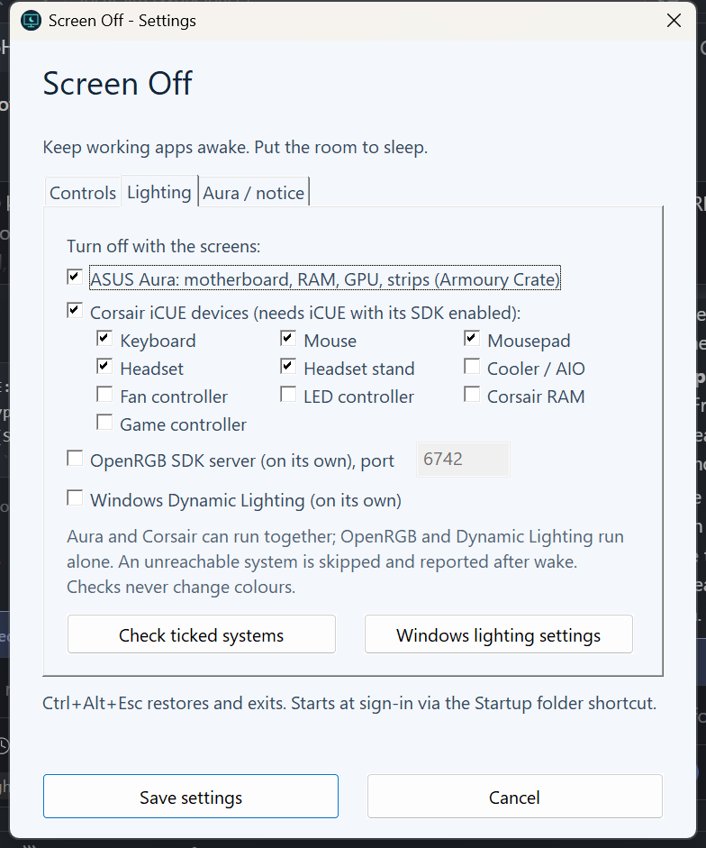

# Screen Off

Turn your monitors **and** your RGB lighting off with one hotkey, while every application keeps
running at full speed. Press a key of your choice to bring everything back.

Built for long renders, downloads, model training or local LLM jobs in a bedroom or office:
the room goes dark, the PC keeps working, and a stray mouse bump does not wake the screens.



## What it does

- **Ctrl+Alt+F12** (configurable): black covers make the screens look off at once; the lighting
  systems and their apps are switched off behind them (Armoury Crate needs a powered display), then
  Windows puts the monitors into standby. The PC stays awake.
- **Space** (configurable), press and release: input is freed, the lighting restore starts in the
  background and the screens come back right away (normally under a second); Armoury Crate's
  window is parked off-screen while it works and closed when done. Windows then locks if
  you enabled "Require Windows sign-in after recovery".
- Armoury Crate is closed at the end of every restore, so nothing is left on screen (during the off
  period it stays open, hidden behind the covers, which keeps the wake-time restore fast). iCUE keeps running in the tray, as the Corsair SDK needs it.
- While dark, mouse movement, clicks and other keys are ignored, so they do not wake the screens.
  **Esc** is the only cancel: while the lights are still switching off it restores everything.
- **Ctrl+Alt+Esc**: restore everything and exit.
- After wake it checks every monitor came back and tells you if one did not, and puts windows back
  on the screen they were on (DisplayPort monitors disconnect while asleep and Windows moves them).
- A tray icon shows the state, keys and the lighting systems in use; double-click for Settings.

Screens are switched off only through **Windows display standby** (the monitor sleeps because the
picture stops, and wakes when it returns). Screen Off never sends a monitor's own "power off"
command over DDC/CI: on a Samsung Odyssey G7 that command left the monitor unreachable. See
[recovery/README.md](recovery/README.md) if that has already happened to you.

## Lighting systems

Tick what to control in **Settings > Lighting**. Each system is independent:

| System | Controls | Needs |
|---|---|---|
| **ASUS Aura** (Armoury Crate) | Motherboard, ASUS GPU, strips, RAM synced in Armoury Crate | Armoury Crate. The *profile* method selects Armoury Crate's own Dark effect (reaches synced RAM) and closes Armoury Crate afterwards; the *SDK* method uses the Aura COM API |
| **Corsair iCUE** | Keyboards, mice, mousepads, headsets, stands, coolers, controllers, RAM (choose types) | iCUE 4.31+ or 5.x with its SDK enabled, the iCUE SDK DLL (`Get-CorsairSdk.ps1`), and a local (not Remote Desktop) session |
| **OpenRGB** | Whatever your OpenRGB server controls | An OpenRGB SDK server already running on this PC. Runs alone |
| **Windows Dynamic Lighting** | Devices that support Dynamic Lighting | Windows 11 23H2+, the registered helper package, background priority. Runs alone |

Aura and Corsair can run together. OpenRGB and Dynamic Lighting drive the same LEDs as the vendor
apps, so each runs on its own. A system that cannot be reached is skipped (the rest still go dark)
and you get a notice after wake. **Check ticked systems** in Settings tests availability without
changing any colour. Device-by-device results: [SUPPORT.md](SUPPORT.md).

## Install

1. Install [AutoHotkey v2](https://www.autohotkey.com/) (or put a portable `AutoHotkey*` folder next
   to this one, or set `SCREENOFF_AHK` to `AutoHotkey64.exe`).
2. Clone or download this repository.
3. Start it: `powershell -ExecutionPolicy Bypass -File .\Start-ScreenOff.ps1`
4. Optional: start it at every sign-in with `.\Install-Startup.ps1` (per user, no admin;
   `-Remove` undoes it).
5. Open **Settings** from the tray icon and tick your lighting systems.

### Corsair setup

1. `.\Get-CorsairSdk.ps1` downloads Corsair's official iCUE SDK releases and checks each SHA-256
   before extracting into `vendor\` (not committed). iCUE 4 needs SDK 4.0.48 (it rejects the newer
   4.0.84 at handshake); iCUE 5 uses 4.0.84. The worker picks the right one automatically.
2. In iCUE turn the SDK on. iCUE 4: Settings (gear) > Software and Games > **Software Integrations**.
   iCUE 5: Settings > SDK > iCUE SDK.
3. Use the PC directly. While Windows is locked or used over Microsoft Remote Desktop, iCUE pauses
   its SDK and even empties its device list, so checks there report that instead of your devices.

When Screen Off releases control, iCUE returns to your own profile and effects.

### Optional helper for OpenRGB and Dynamic Lighting

`.\Build-LightingHost.ps1` builds the .NET helper (needs the .NET 9 SDK).
`.\Install-DynamicLighting.ps1` registers its package identity, which Windows requires for
background Dynamic Lighting control.

## Command line

```powershell
.\Start-ScreenOff.ps1 -Status                                     # show saved settings
.\Start-ScreenOff.ps1 -Settings                                   # open the Settings window
.\Start-ScreenOff.ps1 -Aura 1 -Corsair 1 -CorsairDevices keyboard,mouse
.\Start-ScreenOff.ps1 -OpenRgb 1 -Aura 0 -Corsair 0 -OpenRgbPort 6742
.\Start-ScreenOff.ps1 -LockOnWake 0 -NoticeSeconds 10
.\Start-ScreenOff.ps1 -Backend openrgb -CheckBackend                # read-only availability check
```

Other options: `-DynamicLighting 0|1`, `-AuraMethod profile|sdk`, `-AuraWakeEffect
breathing|rainbow|colorcycle|static|dark`, `-AuraRestorePrevious 0|1`. Changing settings never
turns anything off, and is refused while the screens are off or recovering.

## How it works

`ScreenOffWindows.ahk` is the resident tray app. On the off hotkey it waits for the keys to be
released, covers each monitor with a black window, blocks input and sends Windows display standby.
Only then does it start one worker process per lighting system (`AuraProfileWorker.ps1`,
`AuraWorker.ps1`, `CorsairWorker.ps1`, or the .NET `LightingHost` for OpenRGB and Dynamic Lighting)
and wait for each to report that black was applied. Input hooks swallow mouse and keyboard input
until the wake key is released.
Windows sometimes wakes the display on its own; the utility puts it back to standby, so a brief
flash is possible.

On wake it releases input, powers the display on behind the covers and tells every worker to restore.
The covers lift as soon as no lighting app window can appear (the Armoury Crate worker parks its
window off-screen and signals it); the restore finishes in the background and any problem is
reported afterwards. It locks the session once Windows confirms the display is on. A worker that does not exit within 60 s is ended, which makes its vendor
service restore lighting.

Workers write `logs\rgb-*.log` and `.status` files; the tray menu opens them.

## Tests

`.\Test-ScreenOff.ps1` runs the offline suite: AutoHotkey validation, configuration, wake/lock
ordering, input release, standby preparation, monitor presence, lighting-set aggregation,
PowerShell parsing and simulated OpenRGB protocol tests. Nothing in it turns screens or lights off.
Physical behaviour still needs a person watching the hardware; please report it (see
[CONTRIBUTING.md](CONTRIBUTING.md)).

## Status

Version 1.16. Windows 10/11, AutoHotkey 2.0. Tested on one PC so far; see [SUPPORT.md](SUPPORT.md)
for what has been confirmed on real hardware and what is only implemented.

## License

[MIT](LICENSE). Corsair's iCUE SDK, ASUS Armoury Crate and OpenRGB are separate products under
their own terms and are not included here.
