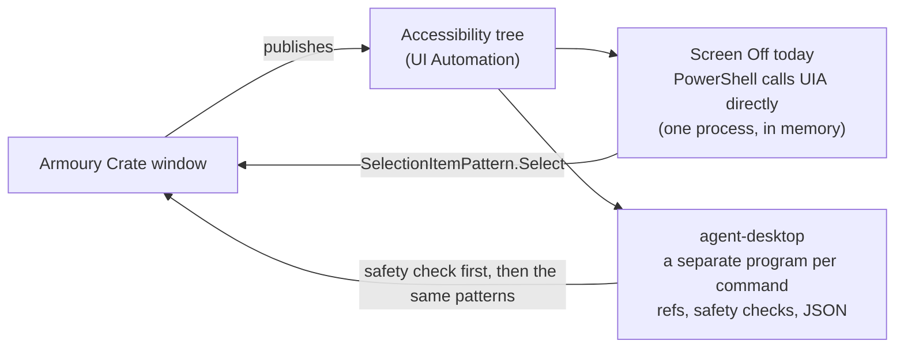

# agent-desktop vs. hand-written UI Automation for Screen Off

*19 November 2026 · Screen Off 1.21 · agent-desktop 1.3.1 · Windows 11 build 26300*

**Decision: Screen Off keeps its own UI Automation code.** agent-desktop found every Armoury Crate control we use,
but it refused to press the two that matter (Dark and Breathing), and every step took 1-3 seconds instead of
milliseconds. The version before this study is archived as git tag `v1.21` (runtime code unchanged).

## 1. The idea in one picture

Both approaches read the same thing: the **accessibility tree**. This is the description of an app's window that
Windows publishes for screen readers, through an API called **UI Automation (UIA)**. Neither approach looks at pixels.



Part of the real tree that agent-desktop printed for the "Lighting & Aura Sync" menu item:

```
window "Armoury Crate"
└─ window "Armoury Crate"
   └─ "Main Navigation View"
      └─ group "Root Split View"
         └─ … group "Navigation View Pane"
            └─ option "Lighting & Aura Sync"     ← ref @s3pktroy8y0264:e1
```

A control can offer several **patterns** (ways to operate it):

| Pattern | What it means | Used by |
|---|---|---|
| `SelectionItemPattern.Select` | "make this the chosen item" (menu entries, tabs, radio buttons) | Screen Off for all four steps; agent-desktop `select` |
| `InvokePattern.Invoke` | "press this button" | agent-desktop `click` (first try) |
| `LegacyIAccessible.DoDefaultAction` | the old pre-UIA "default action" | agent-desktop `click` (fallback) |

## 2. What we tested

Same PC, same Armoury Crate window, parked off-screen exactly as Screen Off does it, then lighting changed for real.

| Step | agent-desktop 1.3.1 | Screen Off's UIA code |
|---|---|---|
| Identify the window | `list-windows` names it `ArmouryCrate.exe` even though a UWP frame hosts it | finds it by name |
| Find "Lighting & Aura Sync" | found in 2.9 s | part of one in-process search |
| Open it | `click`: reported success, **nothing happened** (fallback action, "unverified"). `select`: worked, verified, 2.4 s | `Select`, verified |
| Open "Aura Effects" tab | `select`: worked, verified, 1.8 s | `Select`, verified |
| Find Dark / Breathing | found (`radiobutton`, Breathing marked selected), 1.4-3.3 s | found |
| **Select Dark** | **refused** after 5.4 s: "did not become actionable", check `visible: unknown` | **294 ms, verified** |
| **Select Breathing** | **refused** after 6.0 s, same reason | **36 ms, verified** |
| Same with the window on-screen (behind other windows) | refused again, same reason | n/a |
| Close the window | (`close-app` cannot find hosted UWP apps, issue #555) | `WindowPattern.Close`, 352 ms |

Why the refusal: before every action agent-desktop checks that the control is visible. Armoury Crate's effect
buttons do not report a hidden/offscreen state, so the check answers "unknown", and agent-desktop refuses rather
than guess. No flag turns that check off. The physical-mouse mode (`--headed`) is not an option for a utility that
runs while you sleep, and the vendor says never to use it to recover from a headless failure.

Also tested:

| App | Result |
|---|---|
| Windows Calculator | `find` + `click` for 1 + 2 = read "Display is 3": the general case works. `launch calc` took 30.9 s |
| Corsair iCUE 4 | 25 controls, 4 with names (Home, Dashboard, Murals, CUE4). The profile dropdown is not exposed, so no automation tool can switch iCUE profiles through it |

## 3. Screen Off, part by part

| Part of Screen Off | Today (UIA) | With agent-desktop | Kept |
|---|---|---|---|
| Open Armoury Crate | `shell:AppsFolder` launch, wait for the window | same (its `launch` needs an exe path; UWP apps are not launched by name) | today's |
| Hide the window (park at -32000) | `SetWindowPos` | agent-desktop still sees the window there | today's |
| Detect an empty window after a lock (1.19-1.20) | search for the menu item, give up after 4 s, restart the UI process | would also find nothing; same fix needed | today's |
| Select Dark / Breathing | `SelectionItemPattern.Select` + `IsSelected` check | **refused** (visibility check) | today's |
| Verify each step | `IsSelected` after `Select` | `delivered_verified` / `is --property selected` (same idea) | today's (already does it) |
| Speed of a restore | about 0.3 s once the window is ready | about 10 s of steps, if it worked | today's |
| Locked desktop | cannot work: restore waits for sign-in (1.18) | documented as unsupported | today's |
| Display standby | Armoury Crate builds no UI, so lighting runs behind black covers (1.13) | same limit: no tool can read a UI that does not exist | today's |
| Corsair keyboard | iCUE SDK (no UI at all) | iCUE's UI exposes no profile control | today's |
| Dependencies | Windows only (PowerShell, .NET UIA) | +32 MB npm package, unsigned binary (SmartScreen / Smart App Control may block it), per-user state folder | today's |

What we did take from agent-desktop: nothing new was needed. Its best idea, **verify after every action**, is
already in the worker (`Select-Element` throws unless `IsSelected` becomes true).

## 4. When agent-desktop *is* the better tool

- An AI agent exploring an app it has never seen: `find`, `snapshot`, refs, and structured errors that say whether
  a retry is safe. That is what it is built for.
- Maintenance of Screen Off: when ASUS renames a control, map the new names and ids in seconds:
  `agent-desktop find --app ArmouryCrate.exe --name "Aura Effects" --exact --first` or
  `agent-desktop snapshot --app ArmouryCrate.exe -i --compact`. Then update the constants at the top of
  `AuraProfileWorker.ps1`.

## 5. When to look again

- agent-desktop can act on a control whose visibility is unknown (an override, or a fix for apps like Armoury
  Crate). Worth reporting upstream with this page.
- Hosted UWP apps get consistent names (issue #555).
- A long-running mode (its `batch` command or MCP server) brings the per-step cost down to milliseconds.

## 6. Reproduce

```powershell
npm install agent-desktop@1.3.1 --prefix <dir>        # postinstall checks the release SHA-256
$AD = "<dir>\node_modules\agent-desktop\bin\agent-desktop-win32-x64.exe"
& $AD list-windows
& $AD find --app ArmouryCrate.exe --native-id DarkBtn --first     # → data.match.ref_id
& $AD select '<ref>' "Dark (Off)"                                   # 1.3.1: TIMEOUT, visible unknown
```

Sources: [agent-desktop](https://github.com/vercel-labs/agent-desktop) (README, `skills/agent-desktop-windows`,
`crates/core/src/actionability/gates.rs`), [Windows platform notes](https://agent-browser.dev/desktop/platforms/windows),
[issue #555](https://github.com/vercel-labs/agent-desktop/issues/555). Alternatives reviewed: Windows-MCP, UFO²,
Terminator, pywinauto, FlaUI. For a small fixed job none beats calling UIA directly; FlaUI (C#) would be the upgrade
path if the PowerShell worker ever needs more.
